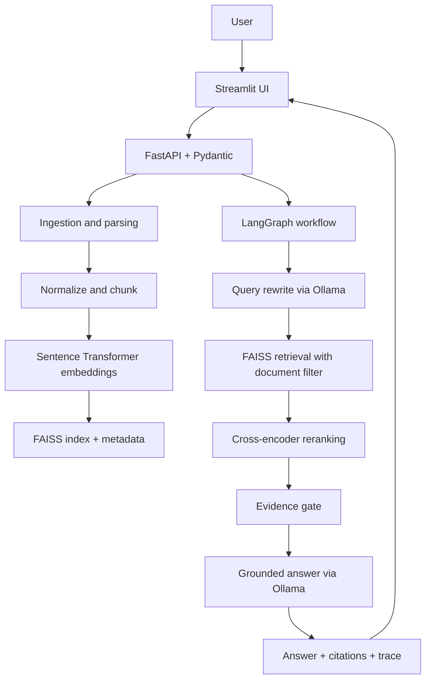

# Klyro-AI — Advanced RAG Assistant

A modular Retrieval-Augmented Generation (RAG) application for grounded Q&A over PDF, TXT and Markdown documents. It uses FastAPI, Pydantic, LangGraph, FAISS, Sentence Transformers, a cross-encoder reranker, Ollama and Streamlit.

## Features

- Multi-format document ingestion (PDF/TXT/Markdown), file-size/type validation (100 MB default; configurable with `MAX_UPLOAD_MB`) and text normalization.
- Page-aware chunking with configurable chunk size and overlap.
- Local embeddings and persistent FAISS vector index with document metadata.
- Document-scoped retrieval and cross-encoder reranking.
- The UI scopes questions to the latest indexed document by default; select other documents or explicitly enable searching all documents.
- LangGraph workflow: query rewrite → retrieval/reranking → evidence gate → grounded generation.
- Citations/evidence snippets, workflow trace, typed request/response schemas and conservative abstention.
- FastAPI Swagger docs, Streamlit UI, pytest tests and Docker Compose.

## Architecture



## Requirements

- Python 3.11 recommended.
- Ollama installed locally, or Docker Compose.
- Internet access on first run to download embedding/reranker model weights.
- Enough RAM for model loading; the cross-encoder and embedding model may be slow on CPU.

## Local setup (macOS/Linux)

1. Install Python 3.11 and Ollama from https://ollama.com/download.
2. In a terminal, enter the project folder and create a virtual environment:

   ```bash
   python3.11 -m venv .venv
   source .venv/bin/activate
   python -m pip install --upgrade pip
   pip install -r requirements.txt
   ```

3. Copy configuration and download the LLM:

   ```bash
   cp .env.example .env
   ollama pull llama3.2:3b
   ```

   Ensure Ollama is running (`ollama serve` if it is not already running as a service).

4. Start the API in terminal 1:

   ```bash
   uvicorn app.main:app --reload --host 0.0.0.0 --port 8000
   ```

5. Start the UI in terminal 2:

   ```bash
   source .venv/bin/activate
   streamlit run frontend/streamlit_app.py
   ```

6. Open http://localhost:8501. API docs: http://localhost:8000/docs.

## Docker Compose

```bash
docker compose up --build -d
docker compose exec ollama ollama pull llama3.2:3b
```

Open http://localhost:8501 and http://localhost:8000/docs. Model downloads for Sentence Transformers happen in the API container on first use. Docker deployment can be memory intensive. The provided Compose setup is a reproducible demo environment, not a hardened multi-tenant deployment.

## API quick reference

- `GET /api/v1/health` — health and index summary.
- `GET /api/v1/documents` — list indexed documents.
- `POST /api/v1/documents` — multipart upload (`file`).
- Maximum upload size defaults to 100 MB. Set `MAX_UPLOAD_MB` to change it; Docker Compose passes this setting to the API.
- `POST /api/v1/ask` — JSON body:

  ```json
  {"question":"What is the main conclusion?", "document_ids": []}
  ```

  Empty `document_ids` searches all indexed documents. Otherwise, retrieval is scoped to the selected document IDs.

The Streamlit UI selects the latest indexed document by default to prevent unrelated earlier uploads from affecting answers. Use “Search all indexed documents” when cross-document answers are intended.

## Tests

```bash
pytest -q
```

Unit tests do not require Ollama. A full end-to-end test requires model downloads and a running Ollama server.

## How quality is improved

1. Query rewriting helps turn follow-up or conversational questions into searchable queries; it falls back to the original question if the LLM is unavailable.
2. FAISS semantic search retrieves candidate chunks; document IDs are filtered before returning results.
3. A cross-encoder reranks candidate passages using query-passage relevance.
4. An evidence gate abstains when no candidate passes the configured similarity threshold.
5. The generation prompt treats document contents as untrusted evidence, instructs the model to use only retrieved context, and requires citations.
6. The UI exposes retrieved passages, scores and workflow trace for inspection.

## Important limitations and next steps for real production

- Current FAISS and metadata storage is process-local and uses local files. Add a database, atomic index updates, tenant/owner ACLs, deletion/reindex endpoints, backup and concurrency strategy before multi-user deployment.
- The `grounded` field is a heuristic, not a formal factuality guarantee. Add a dedicated claim/citation verifier and evaluation dataset.
- Similarity thresholds require calibration on representative questions; scores are not probabilities. Tune with labeled retrieval examples rather than treating confidence as a calibrated probability.
- This initial implementation returns a complete response, not token-by-token streaming. Add SSE/WebSocket streaming if the evaluator requires streaming.
- Add authentication, rate limiting, malware scanning, encrypted storage, observability/metrics, structured logs, tracing, request IDs, and per-user quotas before public exposure.
- Image-only/scanned PDFs need OCR, which is not included in this starter.

## Suggested demo sequence

1. Upload a PDF and a Markdown/TXT file.
2. Show document listing and indexed chunk counts.
3. Ask a question answered directly in one document; point out the citation and evidence chunk.
4. Select one document and ask a question whose answer exists only in another; show that document scoping affects retrieval.
5. Ask an unanswerable question; show the abstention behavior.
6. Expand workflow trace and explain rewrite → retrieve/rerank → evidence gate → generate.
7. Show `/docs`, run tests, and explain production limitations honestly.
